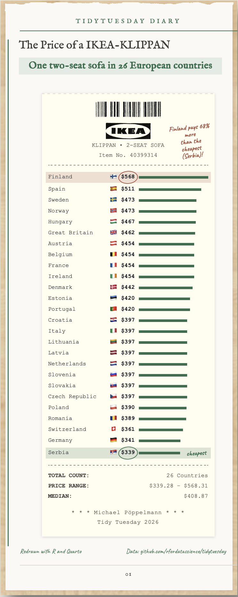

# 🛋️ The Price of an IKEA KLIPPAN: A Receipt in R

A receipt-style bar chart of one IKEA sofa, the **KLIPPAN 2-seat sofa** (item no. 40399314), and what it costs in 26 European countries. The chart is built entirely in R and Quarto, with the page designed in HTML and CSS.

This is my contribution to **TidyTuesday 2026-10-27** (IKEA sofas and their Swedish places).

## 💡 Why this project

The dataset lists the same products in 50 countries, so one product can be compared directly. I picked a single sofa and asked how much its price differs across Europe. Instead of a standard bar chart, I wanted the answer to look like something you would hold in your hand: a shop receipt, pinned to a diary page.

It is also a design exercise. I wanted to see how far I can get with plain HTML and CSS inside a Quarto document, with R generating the content.

## 🖼️ The result



**Key findings**

- Finland is the most expensive country at **$568**, Serbia the cheapest at **$339**.
- Finland pays **68% more** than Serbia for the same sofa.
- The median price across the 26 countries is **$408.87**.
- Many countries share exactly the same price, for example eight countries at $397.

Prices are converted to US dollars. Differences therefore reflect local pricing, taxes and exchange rates together, not the sofa itself.

## 📊 About the data

The data comes from [TidyTuesday 2026-10-27](https://github.com/rfordatascience/tidytuesday/tree/main/data/2026/2026-10-27), curated by [Georgios Karamanis](https://github.com/gkaramanis).

IKEA's founder Ingvar Kamprad had dyslexia and found names easier to remember than number codes. Since December 2020, new sofas and armchairs are named after places in Sweden. KLIPPAN, for example, is a town in Skåne.

| Table | Content |
|---|---|
| Seating products | Every sofa and armchair on ikea.com in 50 countries on 28 September 2026, with prices in local currency and US dollars |
| Swedish places | Places in Sweden that share each product name, from OpenStreetMap |

I use the first table, filtered to one product (`item_no == 40399314`) and the 26 European countries.

## 🚀 What I did

- Filtered the dataset to one product and 26 European countries
- Sorted countries from most to least expensive and scaled each bar to the highest price
- Built the receipt lines as HTML in R, with a country lookup table for names and flags
- Highlighted the most expensive (rose-brown) and the cheapest (green) country with a hand-drawn circle and a handwritten note
- Designed the page in HTML and CSS: paper background, burnt top edge, perforated receipt edge, barcode and logo
- Added an A4 print layout

## 🎨 Design

- A receipt in monospaced type (Courier New), set on a diary page in a serif face (IM Fell English)
- Handwritten annotations in Caveat
- One green for all bars, one rose-brown accent for the highlight
- Chart and layout are created entirely in code, without design software

## 🛠️ Tech stack

- **Language:** R
- **Document:** Quarto (HTML output)
- **Packages:** tidyverse
- **Environment:** RStudio

## 📁 Project structure

```
27-10-2026/
├── code/      27-10-2026.qmd
├── data/      ikea_seating.csv
├── images/    barcode.png, ikea.png, logo1.png, klippan_receipt.png
└── README.md
```

## ▶️ How to run

1. Clone the repository.
2. Open `tidytuesday.Rproj` in RStudio.
3. Install the package: `install.packages("tidyverse")`
4. Open `2026/27-10-2026/code/27-10-2026.qmd` and click **Render**.

An internet connection is needed to load the Google fonts.

## ❓ Questions from the dataset I did not answer

- Where in Sweden do the names come from, and do they cluster around Älmhult in Småland, where IKEA started?
- Which names are sold in the most countries, and which only in a few?
- What kinds of places are they: villages, single farms, lakes, islets?

## 🔗 Sources

- Product listings: ikea.com
- Places: © OpenStreetMap contributors (ODbL), via Nominatim
- Exchange rates: [fawazahmed0 currency API](https://github.com/fawazahmed0/exchange-api) (CC0)
- Dataset: [TidyTuesday](https://github.com/rfordatascience/tidytuesday) by the R4DS Online Learning Community

## 🤝 Credits

Thanks to Georgios Karamanis for curating the dataset. IKEA and KLIPPAN are trademarks of Inter IKEA Systems B.V.; this project is not affiliated with IKEA. The idea, the design decisions and the checks are mine. When I needed to iterate on the code or got stuck, I worked with an AI assistant.
