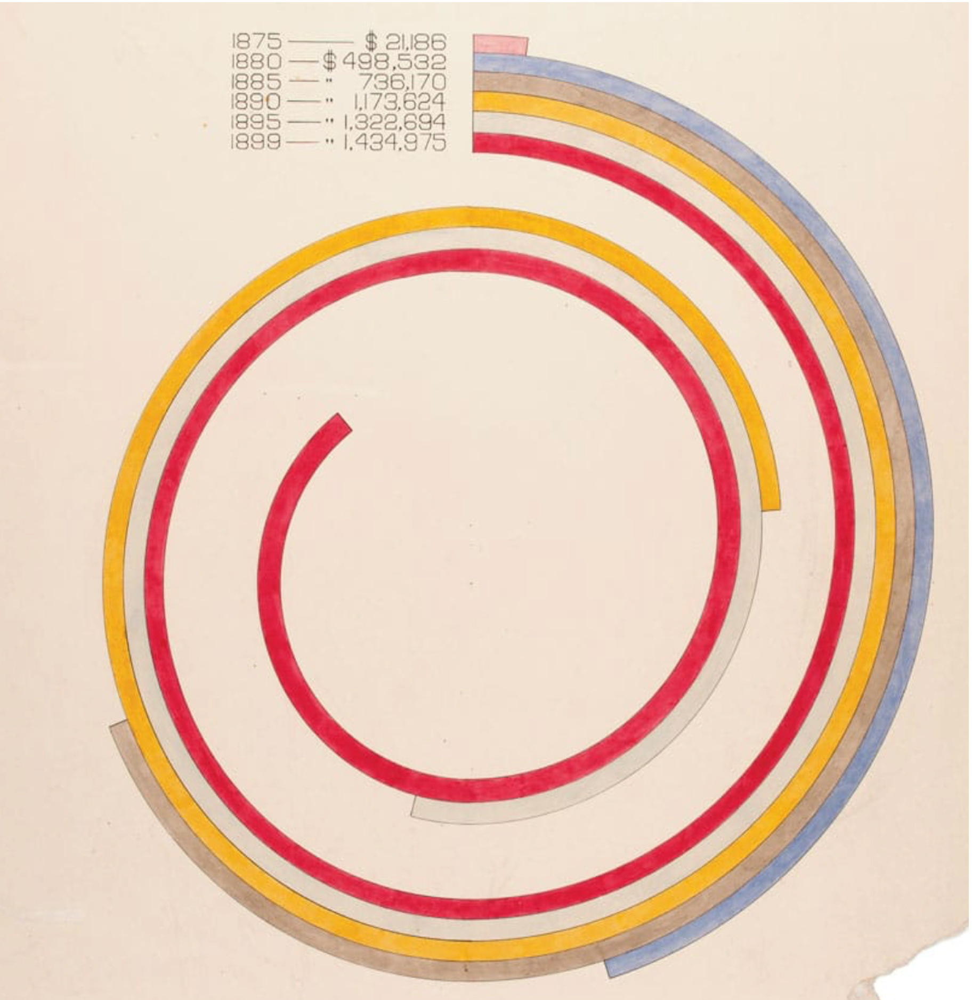
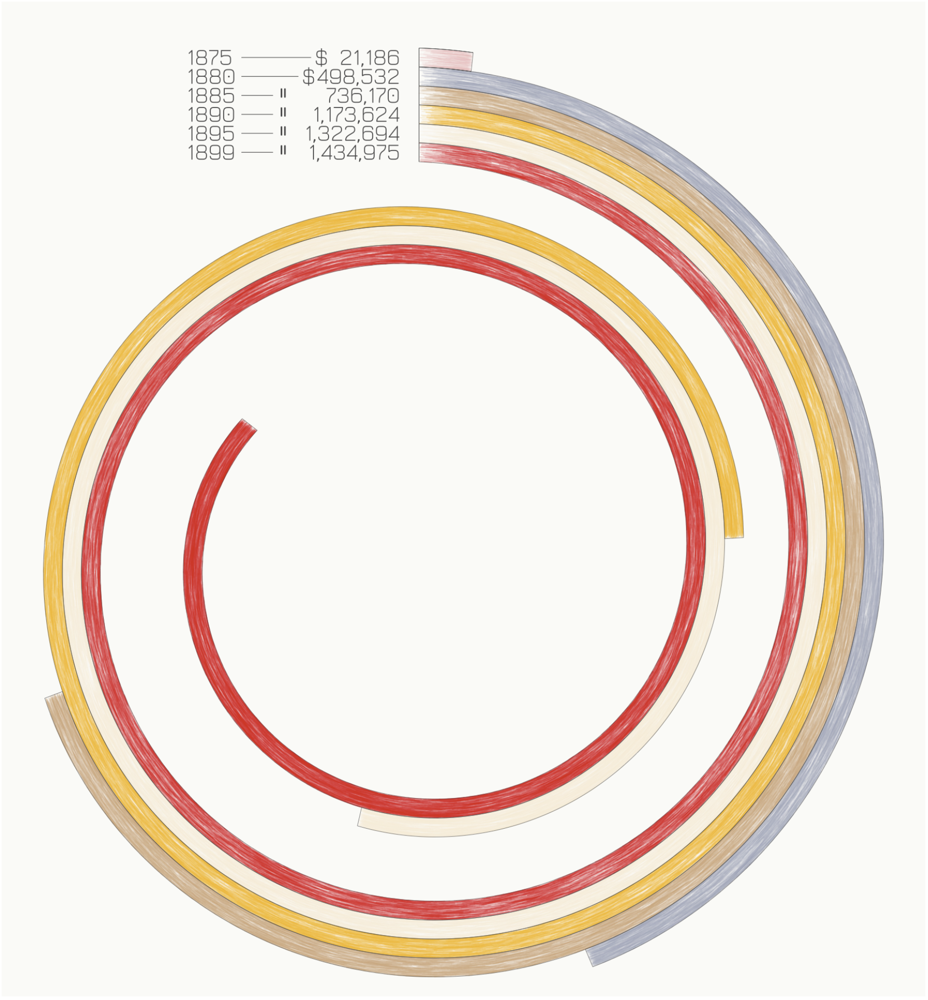
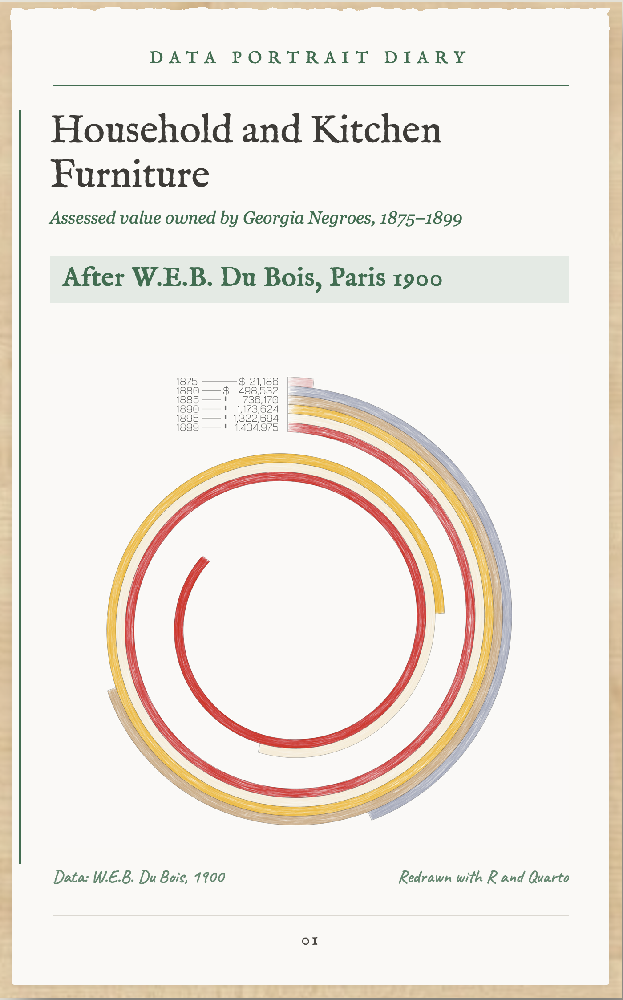

# 🎨 Recreating History with Data: A W.E.B. Du Bois Spiral in R

A modern recreation of one of the data portraits that W.E.B. Du Bois and his students at Atlanta University drew by hand for the 1900 Paris Exposition. The spiral shows the **assessed value of household and kitchen furniture owned by Georgia Negroes, 1875–1899**, and is built entirely in R and Quarto.

## 💡 Why this project

I wanted to find out whether I can rebuild a complex visual design as closely to the original as possible, using only code. What fascinates me most is the colour scheme and the shape of the spiral, with every element in its exact position. Data visualization is an area I want to keep developing in. This is also my first project on GitHub, so I combined both. As a nursing scientist and an advanced beginner in R, I used it to grow with my strengths and my weaknesses, and I share the result including its open points.

## 🖼️ Original and recreation

| Original plate, 1900 | Recreation in R |
|:---:|:---:|
|  |  |

*Original: W.E.B. Du Bois and his students, 1900 Paris Exposition, Library of Congress.*

### How close is it?

I checked the recreation against the original by measuring both images.

* **Ring ends:** all six rings end within about 5° of the original. The end of the 1895 ring is the least certain value, because the band is cream on cream paper and I had to estimate it by eye.
* **Colours:** blue, brown and cream are nearly identical to the original. Red and yellow are slightly paler.

The measurements come from screenshots, so they show the order of magnitude and not an exact value.

### Open points

* red and yellow are a little paler than in the original
* the paper of the original is a warm cream, the recreation page is almost white
* the lettering of the original is technical drawing script, the recreation uses a different typeface
* the hatching texture is my own design choice and not part of the original

## 📄 The finished page

The chart sits on a page styled as a diary sheet, built in HTML and CSS inside the Quarto document.



## 📖 The story

### Historical context

Du Bois presented these plates in Paris to show how African Americans had progressed in the decades after emancipation. The charts were meant to inform, and just as much to counter the racist stereotypes of the time with evidence. They are a political statement, and they are also a piece of design that was far ahead of its time.

### What the plate shows

Each ring is one year. The length of a ring along its curve is proportional to the assessed value. Measured on the original, this is the arc length of the band and not the angle, so the outer rings, which have a larger radius, cover a smaller angle for the same value.

| Year | Value (USD) |
|---|---|
| 1875 | 21,186 |
| 1880 | 498,532 |
| 1885 | 736,170 |
| 1890 | 1,173,624 |
| 1895 | 1,322,694 |
| 1899 | 1,434,975 |

Between 1875 and 1899 the value grew by a factor of almost 70.

## 🚀 What I did

* Redrew the spiral from the original data, with the colours and the labelling of the plate
* Worked out how the ring lengths are defined by measuring the original (arc length, not angle) and rebuilt the geometry accordingly
* Tuned the colours step by step against the original
* Created the coloured-pencil look with many semi-transparent hatching strokes, generated in code
* Built the page around the chart (paper background, burnt top edge, handwritten captions) in HTML and CSS inside a Quarto document

## 🎨 Design

* A six-colour palette taken from the plate, with thin dark outlines on every ring
* Serif and monospaced typefaces for the 1900s feel
* The chart and the page layout are created entirely in code, without any design software

## 🛠️ Tech stack

* **Language:** R
* **Document:** Quarto (HTML output)
* **Packages:** `tidyverse` (including `ggplot2`), `showtext`, `sysfonts`
* **Environment:** RStudio

## 📁 Project structure

```
dubois_circle/
├── code/       du_bois_circle.qmd
├── data/       du_bois_circle_data.csv
├── images/     logo1.png (page background)
├── figures/    du_bois_circle.png (chart), du_bois_page.png (finished page),
│               du_bois_original.jpg (original plate)
└── README.md
```

## ▶️ How to run

1. Clone the repository.
2. Open `tidytuesday.Rproj` in RStudio.
3. Install the packages: `install.packages(c("tidyverse", "showtext", "sysfonts"))`
4. Open `2026/dubois_circle/code/du_bois_circle.qmd` and click **Render**. An internet connection is needed to load the Google fonts.

## 🔗 Sources

* **Data:** [Du Bois Data Portraits](https://github.com/ajstarks/dubois-data-portraits), the repository of the #DuBoisChallenge
* **Original plates:** [Library of Congress, 1900 Paris Exposition collection](https://www.loc.gov/collections/african-american-photographs-1900-paris-exposition/)
* **Further reading:** *W.E.B. Du Bois's Data Portraits: Visualizing Black America*, edited by Whitney Battle-Baptiste and Britt Rusert

## 🤝 Credits

The style and the plate belong to W.E.B. Du Bois and his students. The idea to rebuild it, the decisions about how close to get to the original and the checks against it are mine. When I needed to iterate on the code or got stuck, I worked with an AI assistant.
